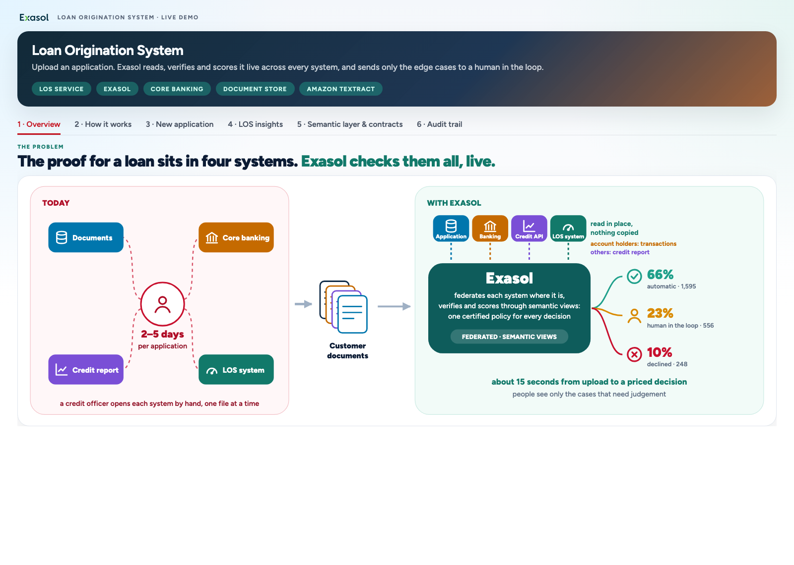
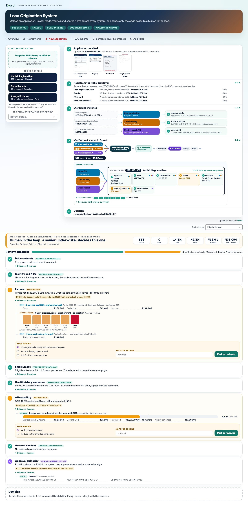
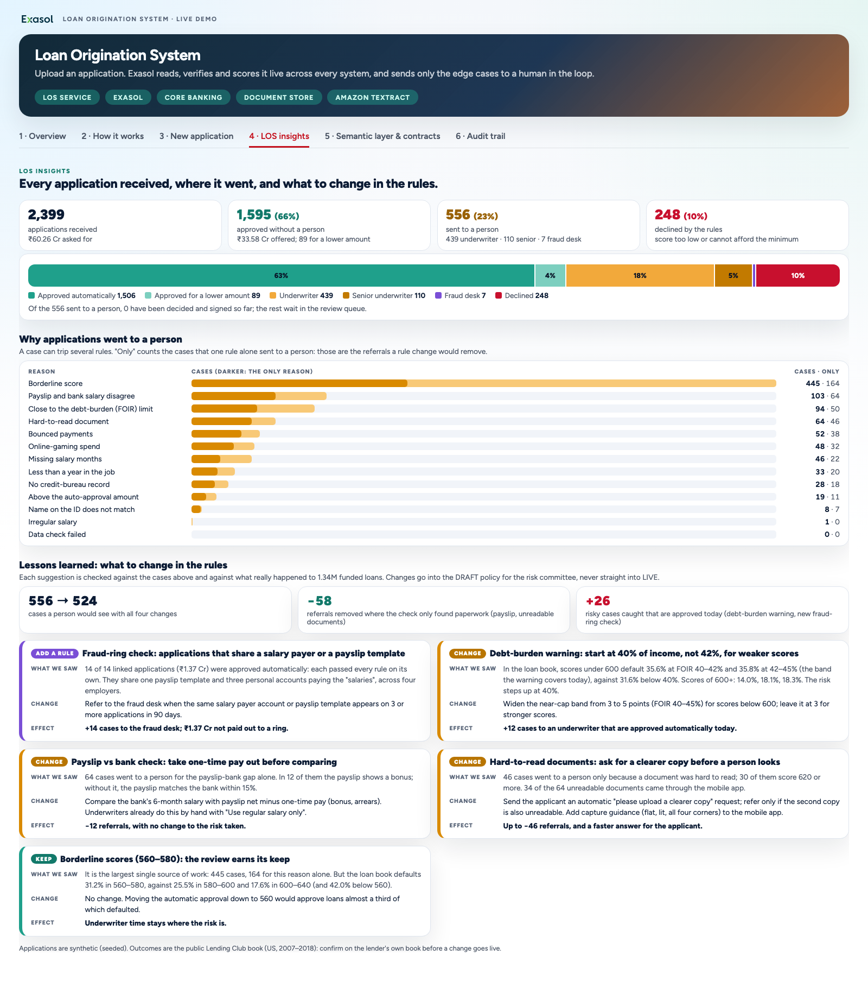
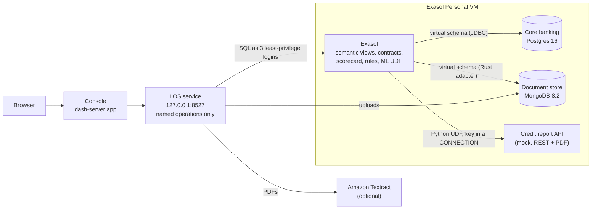

# Loan Origination System on Exasol

A working personal-loan origination demo. An applicant's four PDFs (application form, payslip, PAN card, employment
letter) are uploaded. Amazon Textract reads them. Exasol then checks every claim **live, where the data already lives**:
core banking on Postgres, the document store on MongoDB and a credit bureau's REST API. Nothing is copied. A SQL
scorecard prices the loan, a rule table decides whether a person must look, and edge cases go to an underwriter with a
review checklist. Above their limit a second person countersigns. The decision log is append-only, enforced by
database privileges.

Everything runs on one laptop: Exasol Personal (the free, single-node Exasol database, which runs in a local VM), the
three source systems in containers inside that VM, a small back end, and a web console on dash-server (a starter-kit
add-on that hosts Dash web apps).

> New to the vocabulary? See the [glossary](#glossary). Calling Amazon Textract costs a little money per page; see
> [Cost](#cost). Everything else is free and local.



## What you see

| Tab | What it shows |
|---|---|
| 1 Overview | today (a credit officer opening each system by hand, 2–5 days) against Exasol reading every system in place |
| 2 How it works | documents → Textract → Exasol (federated query, semantic views, data contracts, score + rules + ML) → decision |
| 3 New application | upload a pack, or click a sample: **Divya** (approved automatically), **Karthik** (sent to a person: payslip and bank disagree), **Ananya** (not a bank customer: decided on documents + credit report). Review the checklist, sign, countersign |
| 4 LOS insights | every application received and where it went (approved, sent to a person, declined); which rules sent cases to a person; four rule changes and one rule worth keeping, checked against what really happened to 1.34M funded loans, for example a new rule for applications that share a salary payer or payslip template (14 linked applications each passed every check alone) |
| 5 Semantic layer & contracts | every system names the same fact differently; semantic views give it one name, 13 data contracts guard what each source delivers |
| 6 Audit trail | the decision log, and a tamper attempt the database refuses |





## Architecture



The console holds no credentials and opens no database connection: dash-server forbids it, so every read and write
goes through the LOS service, which accepts named operations only (never SQL) and signs in as the login each job needs.

## Data sources

All of these are created by `setup/install.sh`. Nothing personal or real is included except the public loan history.

| Source | Technology | Contents | Where it comes from |
|---|---|---|---|
| Core banking | Postgres 16, container `los-core-pg` | 2,401 customers, their salary accounts, ~467K transactions (legacy column names, dates as text) | generated, seeded (`data/generate.py`, `data/walkins.py`) |
| Document store | MongoDB 8.2, container `los-docs-mongo` | ~2,400 loan applications and what was read off each PDF, one shape per document type | generated (`data/generate.py`); live uploads are added by the console |
| Credit report API | Python REST service, container `los-bureau-api` | a credit report per PAN, as JSON and as a PDF, behind an API key | `data/bureau_api.py` (mock, stamped SYNTHETIC) |
| Loan book | Exasol table `LOS_BOOK.LOANS` | 1,344,441 real Lending Club loans 2007–2018 with outcomes, USD | downloaded from Hugging Face (`codesignal/lending-club-loan-accepted`, 1.6 GB) and prepared by `data/prepare_book.py` |
| Sample packs | PDFs in `data/packs/<name>/` | the four documents for Karthik, Divya and Ananya | `data/documents.py`, every page stamped SYNTHETIC |

The scorecard (logistic regression) and the ML model (gradient boosting) are trained on the loan book during install.

## Prerequisites

**Host:** tested on **macOS on Apple silicon**. The scripts also handle an x86_64 Exasol VM, but that path has not been
tested. Linux is untested (it needs an Exasol Personal deployment with the same VM layout: `vm-runtime.json`,
`vm-ssh-key`, `vm-shared/`). Windows is not supported: the setup scripts are bash.

Tested with: Exasol Personal Local Starter Kit (`exakit`) 0.2.2, the `exasol` CLI 2.3.0, `exapump` 0.13.0, dash-server
0.1.1. Newer versions are untested; if a step fails, compare `exakit --version` with these first.

- **Exasol Personal Local Starter Kit** ([exasol-labs/exasol-personal-local-starterkit](https://github.com/exasol-labs/exasol-personal-local-starterkit#readme)),
  installed with `curl -fsSL https://www.exasol.com/install/starter-kit.sh | sh` (or download the script, read it, then
  run it: `curl -fsSLo starter-kit.sh https://www.exasol.com/install/starter-kit.sh && sh starter-kit.sh`), and the database running
  (`exakit status`). It provides the `exasol` and `exapump` command-line tools and writes `~/.exapump/config.toml`
  (profile `starter-kit`, used by the setup scripts). The database itself is
  [Exasol Personal](https://github.com/exasol/exasol-personal).
- **dash-server** add-on for the console: `exakit marketplace dash-server`.
- **`python3`, `curl` and `ssh`** on the host (on macOS they come with the Command Line Tools: `xcode-select --install`).
- **Docker Desktop or podman** on the host, only to fetch three public images (`postgres:16`, `mongo:8.2`,
  `python:3.12-slim`). The Exasol VM has no internet access, so images are pulled on the host and streamed in.
- **uv** (`brew install uv`); it installs Python 3.12 for the project if needed.
- About **6 GB** of free disk space (the loan-history download, its prepared copy, the Python environment).
- **Optional:** AWS credentials allowed to call Amazon Textract (`textract:AnalyzeDocument`). Without them, uploads are
  read from the PDFs' text layer instead, and the page says so. Textract is billed by AWS: see [Cost](#cost).

## Cost

Everything runs locally and is free, except **Amazon Textract**, which AWS bills per page. Each uploaded application
sends its pages to `AnalyzeDocument` (QUERIES, plus TABLES for the payslip): about four pages per sample pack, so a few
US cents per application at AWS's published per-page prices. Check
[current Textract pricing](https://aws.amazon.com/textract/pricing/) for your region (`TEXTRACT_REGION`, default
`ap-south-1`). The browser test (`tests/click_test.py`) uploads three packs. Preflight only checks your AWS
credentials (a free call) and never sends a page.

Textract is used whenever AWS credentials are found, **including your default AWS profile**. To make sure nothing is
ever sent to AWS, put `TEXTRACT=off` in `config.local.env`: uploads are then read from the PDFs' text layer, which works
for the sample packs.

## Install

```sh
git clone https://github.com/yuvi-ex/Loan_origination_system.git
cd Loan_origination_system
setup/install.sh
```

It takes about 30 minutes, most of it downloading and loading the loan history. Every step can be re-run; to resume
after a failure: `setup/install.sh --from <step>`; a failed run prints the exact command. If you
already have the Lending Club CSV: `LC_CSV=/path/to/accepted_2007_to_2018Q4.csv setup/install.sh`.

At the end it prints **GO** and the console address, by default http://127.0.0.1:5100/apps/loan-origination/.

What the installer does, in order:

Each line starts with its step names (for `--from`):

1. `check`, `venv`: checks the tools, the database and the VM; creates `.venv` from `requirements.txt`.
2. `sources`: starts the three source containers in the Exasol VM (`setup/00_sources_vm.sh`).
3. `connectors`: installs the connectors under this project's own names (`setup/01_connectors.sh`): the PostgreSQL virtual schema
   adapter and JDBC driver, and the MongoDB virtual schema adapter with its Rust language container (alias `LOSRUST`).
   It installs the JAVA or PYTHON3 language container if one is missing, which restarts the database.
4. `book`, `generate`: downloads and prepares the loan book, trains the scorecard, generates the synthetic lender.
5. `attach`, `documents`, `model`, `facts`, `decisions`: attaches the sources as virtual schemas, loads the book,
   renders the sample PDFs, builds the semantic views, policy and decision views.
6. `logins`, `walkins`: creates three database logins with only the rights each job needs; their passwords and the bureau API key are
   generated into `secrets/app_users.env` (mode 600, git-ignored) and never printed. The source containers' passwords
   are generated the same way into `secrets/sources.env` on the first step; no password is written in the code.
   It also loads the sample applicants who walk in on stage.
7. `ml`: trains the ML model, stores it in BucketFS and scores the book inside Exasol with a Python UDF.
8. `bureau`, `semantic`: starts the credit report API and the UDF that calls it; installs the data contracts and runs
   them once.
9. `service`, `console`, `preflight`: starts the LOS service, deploys the console, runs the preflight check.

Right after install (and after `setup/reset_demo.sh`) the console shows 2,399 applications: 1,595 approved
automatically (66%), 556 sent to a person (23%), 248 declined (10%).

## Configuration

`config.env` holds every setting (ports, container network address, console name, Textract profile and region, time
zone). To change one, put it in `config.local.env` (git-ignored), for example:

```sh
TEXTRACT_PROFILE=my-aws-profile
DASH_APP=loan-demo
TEXTRACT=off          # never call AWS
```

All database objects are prefixed `LOS_`, the containers `los-`, the BucketFS folders `los`, so the project can live next
to other work on the same database.

## Day to day

Run these from the repository root (`cd Loan_origination_system`).

| Task | Command |
|---|---|
| Before a demo: GO / NO-GO, starts what is stopped | `setup/preflight.sh` (add `--reset` for a clean start) |
| Back to the starting state (no uploads, empty log, policy v1) | `setup/reset_demo.sh` |
| Start the LOS service | `service/run.sh` |
| Redeploy the console after a change | `.venv/bin/python dash/deploy.py` |
| Start the containers after the VM restarted | `setup/00_sources_vm.sh` (preflight does it) |
| Shell inside the Exasol VM | `setup/vm.sh '<command>'` |
| Browser test of every tab | `.venv/bin/python -m playwright install chromium`, then `.venv/bin/python tests/click_test.py .work/shots`, then `setup/reset_demo.sh` |
| Stop after the demo (the service and the three containers keep running otherwise) | `pkill -f "$PWD/service/los_api.py"`, then `setup/vm.sh 'podman stop los-core-pg los-docs-mongo los-bureau-api'` |
| Remove what this project created in Exasol, the VM and dash-server | `setup/uninstall.sh --yes` (keeps `.venv` and `.work`, about 6 GB with the download: `rm -rf .venv .work` frees them; keeps the shared Postgres JDBC registration, any JAVA/PYTHON3 language container the installer added, and the
three container images, which other projects may share: `setup/vm.sh 'podman rmi localhost/postgres:16 localhost/mongo:8.2 localhost/python:3.12-slim'`) |

## Repository layout

| Path | What |
|---|---|
| `setup/` | installer, connectors, sources, logins, ML, bureau API, semantic layer, preflight, reset, uninstall |
| `sql/` | the data model: semantic views (`10_src`), policy (`15_policy`), facts (`20_facts`), decisions (`30_decisions`), back-test, fraud, ML, semantic layer and contracts, bureau API UDF |
| `data/` | generators and loaders: loan book, scorecard, ML training, synthetic lender, PDFs, walk-in customers, mock bureau |
| `service/` | the LOS service: operations, upload pipeline, document reader (Textract with a text-layer fallback), SQL |
| `dash/` | the console (Dash on dash-server, which provides `dash` and `flask`: they are not in `requirements.txt`) and `deploy.py` |
| `data/packs/`, `data/docs/` | the sample applications to upload, and sample documents to open by hand, among them two of the fraud ring's payslips (same template, different "employers"); all generated by `data/documents.py` |
| `tests/` | headless browser click-through |
| `docs/` | the screenshots in this README |
| `config.env`, `los_config.py` | settings, read by the shell scripts and the Python code |
| `requirements.txt`, `.python-version` | pinned Python dependencies, Python 3.12 |
| `VALIDATION_CHECKLIST.md`, `.claude/` | the release checks for this repository (by hand, or `/validate-repo` in Claude Code) |

## Things that will bite

- **"Registry full":** after a burst of Postgres virtual-schema queries, Exasol Personal can run out of ETL channels and
  every Postgres import hangs for minutes. Restart the database before a demo (`exasol stop && exasol start`; add
  `-d <name>` to both if you changed `EXASOL_DEPLOYMENT`), then run `setup/preflight.sh`.
- **After the VM restarts** the source containers do not come back by themselves: run `setup/preflight.sh`.
- **MongoDB 8.0 / latest will not boot** on recent kernels; the scripts pin `mongo:8.2`.
- **The ML pickle must be trained with the library versions inside Exasol** (numpy 1.26.4, scikit-learn 1.7.2):
  `setup/06_ml.sh` builds a pinned training environment in `.work/mlenv` for that.
- **Keep the laptop awake** during a demo or a test (`caffeinate -i …` on macOS); a sleeping machine looks like a hang.
- **Dates:** the synthetic bank data runs to 24 Oct 2026, and an application is judged on the six full months before
  its month. Live uploads are therefore dated `APP_DATE` (config.env, 27 Oct 2026) whatever today's date is; dated
  later, the sample applicants would show a missing month of salary.
- **Session cap:** Exasol Personal allows 20 sessions; the LOS service holds 3.

## What is real

Exasol, the virtual schemas, the SQL decision engine, the privileges, the UDFs and the Textract calls are real and
running. The customers, transactions, applications, credit reports and PDFs are synthetic; no real person, employer,
lender or bureau is involved. Banks and lenders carry well-known fictional names (Woodgrove, Contoso, Fabrikam,
Northwind…), bank codes are made up, phone numbers start with `00000` and cannot be dialled, and email addresses use
the reserved `example.com` domain. The 1.34M-loan history is real public Lending Club data, in USD.

## Glossary

| Term | Meaning |
|---|---|
| PAN | India's Permanent Account Number, the tax ID printed on a PAN card |
| ₹ L (lakh) | 100,000 rupees; ₹12.0 L = ₹1,200,000 |
| EMI | equated monthly instalment: the fixed monthly repayment of a loan |
| FOIR | fixed obligations to income ratio: all EMIs, including the new one, divided by net monthly income |
| IFSC | the 11-character code of an Indian bank branch (here: fictional) |
| Virtual schema | Exasol tables that query a remote system (here Postgres and MongoDB) live, without copying ([docs](https://docs.exasol.com/db/latest/database_concepts/virtual_schemas.htm)) |
| UDF | a user-defined function in Python, Java or Rust that runs inside Exasol, next to the data |
| Language container (SLC) | the runtime a UDF language needs inside Exasol; `LOSRUST` is this project's Rust one |
| BucketFS | Exasol's file store for UDF code, drivers and models |
| CONNECTION | an Exasol object holding an address and a secret, usable by a script without anyone reading the secret |
| ₹ Cr (crore) | 10,000,000 rupees = 100 L |
| Underwriter | the credit officer who reviews the cases sent to a person; above their limit a second person countersigns |
| Scorecard | a points-based credit model; here a logistic regression trained on the loan book |
| Federated query | one SQL statement that reads several remote systems in place, through virtual schemas |
| Semantic view | a view that gives one business name to a fact each source names differently |
| Data contract | a declared rule a source must meet (13 here), checked on every application |
| ETL channels | the slots Exasol uses for IMPORT/EXPORT; "Registry full" means they ran out (see *Things that will bite*) |

## Support and contributing

This is a demo, provided as is; it is not production lending software. Questions and bug reports: open an issue at
https://github.com/yuvi-ex/Loan_origination_system/issues. Pull requests are welcome; see
[CONTRIBUTING.md](CONTRIBUTING.md). To report a security problem privately, see [SECURITY.md](SECURITY.md).

## License

MIT, see [LICENSE](LICENSE).

Third-party material, none of it redistributed here: the Lending Club loan history is downloaded at install time from
[codesignal/lending-club-loan-accepted](https://huggingface.co/datasets/codesignal/lending-club-loan-accepted) on
Hugging Face, published there under CC0 1.0. Container images are pulled from Docker Hub under their own licenses
(MongoDB Server: SSPL; PostgreSQL: PostgreSQL License; Python: PSF). Python packages are installed by you from PyPI
under their own licenses (psycopg is LGPL-3.0). The Exasol name and logo (`dash/assets/`) are trademarks of Exasol AG
and are not covered by the MIT license. The console loads the Figtree and JetBrains Mono fonts from Google Fonts (SIL Open
Font License); offline it falls back to system fonts.

In the console, who signs a decision is the name chosen under "Reviewing as": the demo does not log reviewers in. The
database enforces that the decision log only grows, but a real system must tie each signature to an authenticated user.
